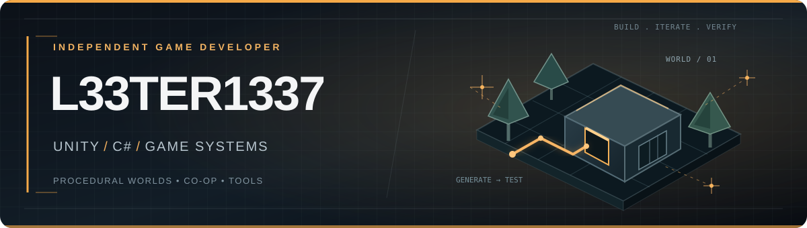

  

  <h3>Game developer · Unity / C#</h3>
  
Building interactive worlds, gameplay systems, and developer tools.

  

    
    
    
    
  

---

### Selected work

**QUOTA SLOP** · *In development · Private repository*  
A Unity game project focused on procedurally generated environments and survival-horror systems. Current engineering work includes **CavityWorld** world generation, Cavity-based geometry tooling, multiplayer systems, and performance optimization. Features are actively being tested and refined.

**[Hard Blood](https://daniilka1337games.itch.io/hard-blood)** · *Earlier game project*  
A previously published project that is part of my game-development journey.

### What I build

| Game systems | World & tools | Engineering |
| :--- | :--- | :--- |
| First-person gameplay | Procedural environments | C# architecture |
| Co-op networking | 3D geometry tooling | Performance profiling |
| AI and enemy behaviors | Editor workflows | Debugging & iteration |

### Development approach

`Prototype` → `Implement` → `Commit` → `Test in Unity` → `Fix regressions` → `Repeat`

I value practical systems, fast iterations, and testing the actual game—not just code that looks complete in a commit.

---

Independent game development • Learning by shipping and improving real projects

