### Need a Unity issue fixed or a game system built?

**Unity / C# · Editor tooling · Multiplayer · Procedural worlds · ML-Agents**

[**Request a project quote ↗**](https://github.com/l33ter1337/l33ter1337/issues/new) &nbsp;·&nbsp; [**See published game ↗**](https://daniilka1337games.itch.io/hard-blood)

---

### What I can help with

| Specialty | Freelance tasks |
| :-- | :-- |
| **Unity / C# fixes** | Compile errors, broken gameplay, editor issues, unexpected runtime behaviour |
| **Gameplay & tools** | Game systems, custom Unity Editor tools, procedural level generation |
| **Multiplayer & ML** | FishNet integration, Unity ML-Agents, trained game agents (drones and vehicles) |
| **Performance** | Profiling, optimisation, runtime bottlenecks |

### Selected work

**[Hard Blood](https://daniilka1337games.itch.io/hard-blood)** · Published game

### Work with me

**Open to freelance inquiries.** Short Unity fixes and larger scoped projects are both welcome. Pricing is agreed individually based on the task.

[**Start a project inquiry on GitHub →**](https://github.com/l33ter1337/l33ter1337/issues/new) · [**Machine-readable services (JSON)**](./services.json)

GitHub Issues are public. Please don't share private source code, credentials or confidential project data in an issue.
