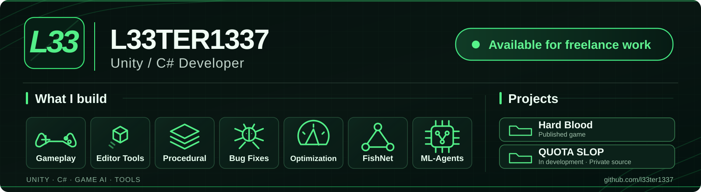

**Unity / C# game development — open to freelance work**

[**Discuss a Unity project**](https://github.com/l33ter1337/l33ter1337/issues/new) · [**Hard Blood (itch.io)**](https://daniilka1337games.itch.io/hard-blood)

---

### Services & skills

**Unity / C#:** gameplay systems, bug fixing, Unity Editor tools, procedural generation, performance optimisation.

**Multiplayer & ML:** FishNet, Unity ML-Agents, training and integration of game AI agents including drones and vehicles.

### Selected work

**[Hard Blood](https://daniilka1337games.itch.io/hard-blood)** — an earlier published game.

**QUOTA SLOP** — a Unity project in active development, covering procedural CavityWorld environments, game systems, co-op, tooling and ML-Agents. **Source code is private.**

### Freelance inquiries

Available for focused Unity fixes, gameplay features, custom editor tooling and larger scoped tasks. Quotes depend on scope and requirements.

[**Contact via GitHub Issues →**](https://github.com/l33ter1337/l33ter1337/issues/new)

GitHub Issues are public. Please don't post private code, credentials, or sensitive project material there.
