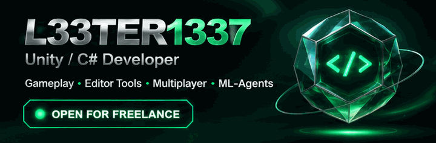
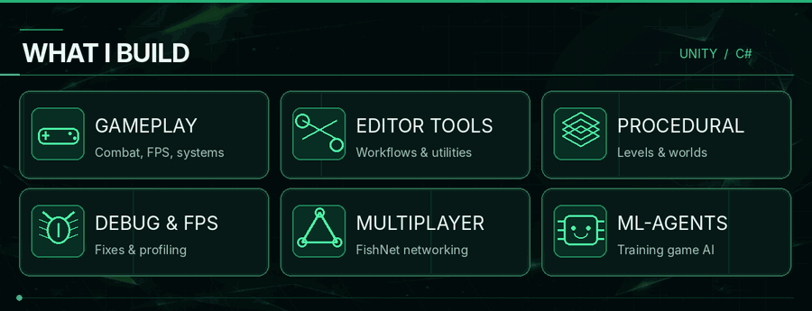
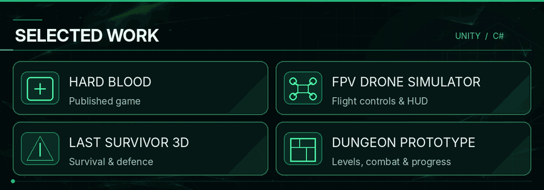

**Unity / C# Game Developer · Gameplay · Tools · FishNet · ML-Agents**

**[See my published game: Hard Blood ↗](https://daniilka1337games.itch.io/hard-blood)** &nbsp;·&nbsp; **[Public questions ↗](https://github.com/l33ter1337/l33ter1337/issues/new)**

<b>Explore my technical skills</b>

- **Gameplay / C#:** first-person interactions, combat, movement, game modes, progression and HUD systems.
- **Unity Editor tools:** custom inspectors, scene utilities and authoring workflows.
- **Procedural generation:** levels, dungeons, environments and generated 3D geometry.
- **Debugging & performance:** compiler/runtime bugs, troubleshooting, profiling and optimisation.
- **Multiplayer:** FishNet integration, gameplay spawning and synchronisation.
- **ML-Agents / game AI:** training and integration of game agents, including drones and vehicle agents.
- **Prototyping:** FPV flight, jetpack movement, survival systems, mining/clicker economies.

**[Hard Blood — published on itch.io ↗](https://daniilka1337games.itch.io/hard-blood)**

<b>More games & development history</b>

**Game prototypes documented in 2025 announcements and screenshots**

- **Nubik: Last Survivor 3D** — missions, base defence and an endless survival mode.
- **Nubik: Mining Clicker** — resource collection, upgrades, graphics options and performance updates.
- **FPV Drone Simulator 3D** — drone controls, FPV camera and combat-oriented HUD.
- **Jetpack Obby (Nubik)** — jetpack movement, obstacle courses, timing and upgrades.
- **Mining Clicker** — workers, mining economy and user interface.
- **Best in the Dungeon** — dungeon gameplay, random locations, combat and character progression.

**Earlier work:** Voxel Bullet → Critical Bullet, and the Reveu Games development history.

**Collaboration:** assisted game developer and 3D artist **Hesing** with model-related work. [See an example of the artist's work on Sketchfab](https://sketchfab.com/3d-models/mcmillan-cs5-e919bb3a074f489ab29bc96cf3bee172). This link credits the artist and does not claim authorship of that model.

*These are historical portfolio examples; current download availability is not guaranteed.*

---

### Available for freelance work

**Need a Unity bug fixed, a gameplay feature built, or a custom Editor tool?** I take on focused tasks and scoped projects. Pricing depends on the requirements.

**Private inquiries:** a confidential contact channel has not been published yet.

[**Public questions only — GitHub Issues ↗**](https://github.com/l33ter1337/l33ter1337/issues/new) &nbsp;·&nbsp; [**Services for tools & agents (JSON) ↗**](./services.json)

GitHub Issues are public. Please don't post budgets, credentials, private project files or confidential client information.
