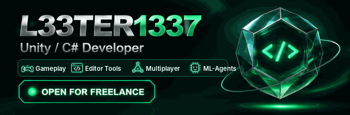
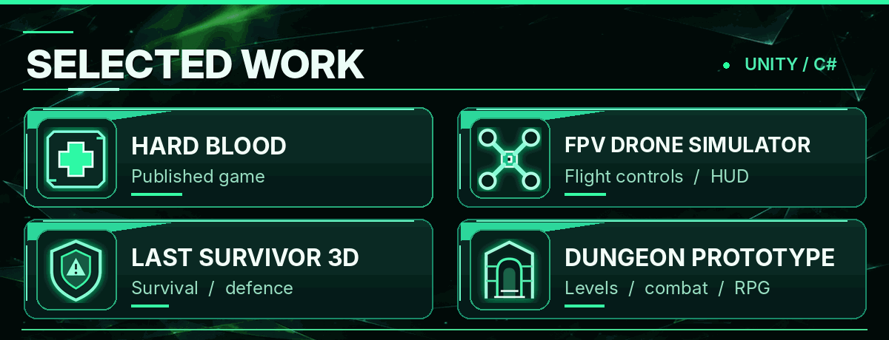
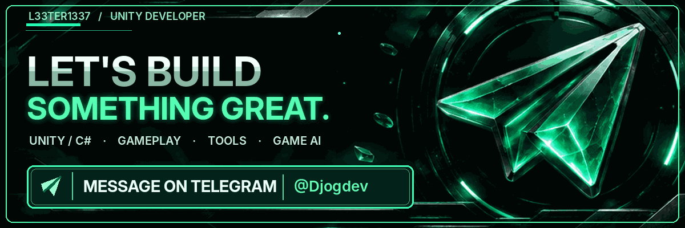

**UNITY / C# DEVELOPER · GAMEPLAY · TOOLS · FISHNET · ML-AGENTS**

**Need a Unity feature, a bug fix, or a custom Editor tool?**

[**💬 HIRE ME — PRIVATE TELEGRAM MESSAGE ↗**](https://t.me/Djogdev) &nbsp;·&nbsp; [**🎮 VIEW PUBLISHED GAME ↗**](https://daniilka1337games.itch.io/hard-blood)

**Unity development services:** gameplay mechanics, bug fixing, Editor tools, procedural content, FishNet multiplayer and ML-Agents.

<b>See technical capabilities</b>

- **Gameplay engineering:** first-person controls, combat, movement, interactions, game modes, HUD and progression.
- **Unity Editor tools:** custom inspectors, scene utilities and level-authoring workflows.
- **Procedural content:** 3D environments, dungeon layouts, level generation and geometry.
- **Debugging & optimisation:** C# compiler/runtime errors, gameplay regressions, profiling and scene-loading performance.
- **Multiplayer / FishNet:** gameplay integration, spawning and synchronisation.
- **ML-Agents / game AI:** training and integrating game agents, including drones and vehicles.
- **Prototyping:** FPV flight, jetpack mechanics, survival modes and mining/clicker economies.

**[🎮 Hard Blood — Play / view the published game on itch.io ↗](https://daniilka1337games.itch.io/hard-blood)**

<b>Explore previous games and development experience</b>

**Projects documented in 2025 announcements and screenshots**

- **FPV Drone Simulator 3D** — drone flight controls, first-person camera and combat-oriented HUD.
- **Nubik: Last Survivor 3D** — survival missions, base defence and an endless mode.
- **Best in the Dungeon** — dungeons, random locations, combat and character progression.
- **Nubik: Mining Clicker** — resources, upgrades, graphics settings and performance work.
- **Jetpack Obby** — jetpack movement, obstacle courses, timers and upgrades.
- **Mining Clicker** — workers, resource collection, upgrades and game UI.

**Earlier development:** Voxel Bullet → Critical Bullet, associated with the Reveu Games history.

**3D collaboration:** assisted developer and artist **Hesing** with model-related work. [Example of Hesing's own Sketchfab work ↗](https://sketchfab.com/3d-models/mcmillan-cs5-e919bb3a074f489ab29bc96cf3bee172). The linked model is the artist's work; it is not presented as my own.

Older projects are historical examples documented in archived materials; their current availability is not guaranteed. Some names are descriptive English translations.

---

**HAVE A UNITY PROJECT IN MIND?**

Send a brief description of what you need built or fixed. We can discuss scope, timing and pricing one-to-one.

[**💬 MESSAGE @DJOGDEV ON TELEGRAM ↗**](https://t.me/Djogdev)

For general non-confidential questions, use [GitHub's public question form](https://github.com/l33ter1337/l33ter1337/issues/new/choose). GitHub Issues are visible to everyone — never share credentials, private source code or client details there.

[**Services & skills for search tools and agents (JSON) ↗**](./services.json)

