[**Discuss a Unity project**](https://github.com/l33ter1337/l33ter1337/issues/new) · [**Hard Blood — published game**](https://daniilka1337games.itch.io/hard-blood)

### Skills & freelance services

**Unity / C#** · Gameplay systems · Debugging · Editor tools · Procedural generation · Optimisation

**Networking & game AI** · FishNet · Unity ML-Agents · Training game agents (drones and vehicles)

### Projects

**[Hard Blood](https://daniilka1337games.itch.io/hard-blood)** — published game.

**QUOTA SLOP** — in-development Unity project featuring CavityWorld procedural generation, custom tooling, co-op, and ML-Agents. *Source repository is private.*

### Freelance contact

Available for Unity fixes, systems, and custom tools. Scope and price are agreed per project.

[**Get in touch via GitHub →**](https://github.com/l33ter1337/l33ter1337/issues/new)

GitHub Issues are public. Don't post credentials, private code or confidential material.
