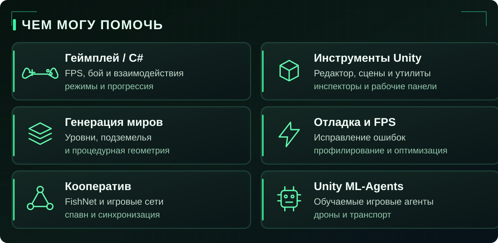
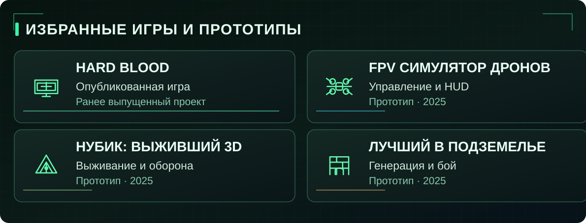

**🇷🇺 Русский** &nbsp;·&nbsp; [**🇬🇧 English →**](./README_EN.md)

### Разработчик игр на Unity / C#

**Игровые механики · Инструменты Unity · FishNet · ML-Agents · Оптимизация**

[**🎮 Hard Blood — опубликованная игра**](https://daniilka1337games.itch.io/hard-blood) &nbsp;·&nbsp; [**💬 Публичные вопросы**](https://github.com/l33ter1337/l33ter1337/issues/new)

### 🧩 Чем могу помочь

<b>Подробнее о навыках</b>

- **Unity / C#:** управление персонажем, боевые и игровые механики, режимы, прогрессия, интерфейсы.
- **Инструменты редактора:** собственные инспекторы, утилиты и инструменты создания уровней.
- **Процедурная генерация:** уровни, подземелья и 3D-геометрия.
- **Отладка и оптимизация:** ошибки компиляции и исполнения, профилирование, узкие места производительности.
- **Мультиплеер:** работа с FishNet и интеграция сетевых игровых систем.
- **Машинное обучение:** Unity ML-Agents, обучение и интеграция игровых агентов, включая дронов и транспорт.

### 🕹️ Избранные работы

**[Смотреть Hard Blood на itch.io →](https://daniilka1337games.itch.io/hard-blood)**

<b>Остальные проекты и история разработки</b>

**Проекты 2025 года** — по сохранённым публикациям и скриншотам:

- **Нубик — Последний выживший 3D:** вылазки, оборона базы, бесконечный режим.
- **Нубик — кликер копальщик:** добыча, улучшения, настройки графики, работа над производительностью.
- **FPV Симулятор Дронов 3D:** управление дроном, FPV-камера, игровой интерфейс.
- **Обби — Но ты Нубик на джетпаке:** движение на джетпаке, препятствия, таймер, улучшения.
- **Кликер копальщик:** добыча ресурсов, рабочие, экономика, интерфейс.
- **Лучший в подземелье:** подземелья, бой, развитие персонажа и случайные локации.

**Более ранние проекты:** Voxel Bullet → Critical Bullet, история Reveu Games.

**Сотрудничество:** помогал разработчику и 3D-художнику **Hesing** в работе с моделями. [Профильный пример его работы на Sketchfab](https://sketchfab.com/3d-models/mcmillan-cs5-e919bb3a074f489ab29bc96cf3bee172). Авторство конкретной модели себе не приписываю.

*Старые проекты приведены как примеры опыта; они не обязательно доступны для скачивания сейчас.*

### 💼 Заказы и сотрудничество

**Открыт к фриланс-задачам:** исправление ошибок Unity/C#, игровые механики, инструменты редактора, прототипы, генерация уровней и игровой ИИ. Стоимость обсуждается индивидуально.

**Личные обращения:** конфиденциальный способ связи ещё не опубликован.

[**Публичные вопросы — GitHub Issues →**](https://github.com/l33ter1337/l33ter1337/issues/new) &nbsp;·&nbsp; [**Навыки и услуги для автоматического чтения (JSON)**](./services.json)

GitHub Issues видны всем. Не публикуйте там бюджеты, приватные исходники, пароли или конфиденциальные сведения.

[**🇬🇧 Switch to English →**](./README_EN.md)

