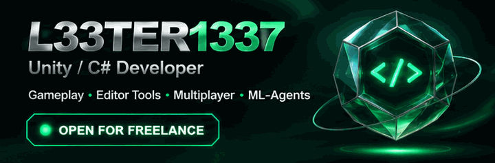
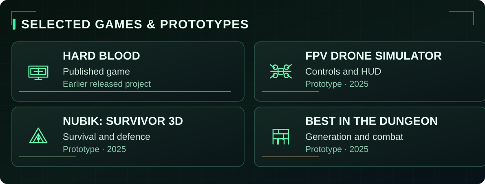

**🇬🇧 English** &nbsp;·&nbsp; [**🇷🇺 Switch to Russian →**](./README.md)

### Independent Unity / C# Game Developer

**Gameplay Engineering · Editor Tools · Procedural Generation · FishNet · ML-Agents**

I create game systems, tools and prototypes — from gameplay features and debugging to procedural environments and game AI.

[**🎮 View Hard Blood — published game**](https://daniilka1337games.itch.io/hard-blood) &nbsp;·&nbsp; [**💬 Ask a public question**](https://github.com/l33ter1337/l33ter1337/issues/new)

---

### 🧩 What I can build

<b>View skills and technical experience</b>

**Gameplay & C#**
- First-person controls, combat, interactions, game modes and progression.
- HUDs, game economy, upgrades and gameplay prototyping.

**Unity tools & procedural content**
- Editor utilities, custom inspectors and scene-authoring workflows.
- Procedurally generated levels, dungeons, environments and 3D geometry.

**Debugging & performance**
- Unity compiler and runtime issues, game logic, bottleneck investigation and optimisation.
- Work on scene loading, graphics settings and 3D asset performance.

**Multiplayer & machine learning**
- FishNet networking and multiplayer gameplay integration.
- Unity ML-Agents training and game-agent integration, including drones and vehicles.

### 🕹️ Selected games and prototypes

**[Hard Blood](https://daniilka1337games.itch.io/hard-blood)** — a published independent game. [View its game page →](https://daniilka1337games.itch.io/hard-blood)

**2025 game development archive** — documented through saved announcements, screenshots and version updates:

| Project | Gameplay and technical focus |
| :-- | :-- |
| **Nubik: Last Survivor 3D** | Survival missions, base defence and an endless mode |
| **Nubik: Mining Clicker** | Resource gathering, upgrades, graphics settings and performance updates |
| **FPV Drone Simulator 3D** | Drone controls, first-person camera, flight HUD and combat-oriented gameplay |
| **Jetpack Obby (Nubik)** | Jetpack movement, obstacle courses, timers and upgrades |
| **Mining Clicker** | Workers, mining economy, upgrades and game UI |
| **Best in the Dungeon** | Dungeon gameplay, random locations, combat and character progression |

English names above are descriptive translations of earlier project titles. These are historical projects, not a claim that all games remain downloadable or supported.

<b>Earlier game history and collaborations</b>

**Voxel Bullet → Critical Bullet** — an earlier game project associated with the **Reveu Games** development history.

**3D asset collaboration with Hesing** — assisted developer and 3D artist **Hesing** with model-related work. [See an example from the artist's Sketchfab portfolio](https://sketchfab.com/3d-models/mcmillan-cs5-e919bb3a074f489ab29bc96cf3bee172). The linked model belongs to the artist; I am not claiming to have created that specific asset.

My work across these projects includes experiments in survival, combat, procedural environments, game UI, simulators, clicker economies and level-based challenges.

### 💼 Available for freelance work

I can help with **Unity/C# bugs, gameplay features, custom Editor tools, game prototypes, procedural systems and game AI**. Small focused tasks and larger scoped work can both be discussed.

**Pricing:** quoted individually based on the request and its scope.

**Contact:** a private inquiry channel is being prepared. Until it is available, GitHub Issues may be used **only for non-confidential public questions**.

[**Public questions — GitHub Issues →**](https://github.com/l33ter1337/l33ter1337/issues/new) &nbsp;·&nbsp; [**Machine-readable services (JSON) →**](./services.json)

GitHub Issues are public. Never post client budgets, private project details, credentials or confidential source code there.

---

[**🇷🇺 Read the Russian version →**](./README.md) &nbsp;·&nbsp; [**Return to GitHub profile →**](https://github.com/l33ter1337)

