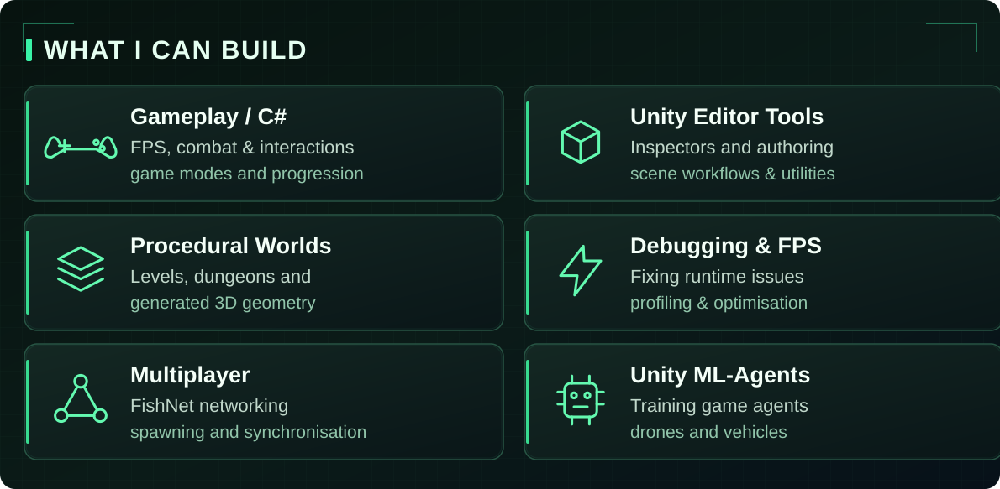

[**🇷🇺 Русский ←**](./README.md) &nbsp;·&nbsp; **🇬🇧 English**

### Unity / C# Game Developer

**Gameplay · Unity Editor Tools · FishNet · ML-Agents · Performance**

[**🎮 Hard Blood — published game**](https://daniilka1337games.itch.io/hard-blood) &nbsp;·&nbsp; [**💬 Public questions**](https://github.com/l33ter1337/l33ter1337/issues/new)

### 🧩 What I can build

<b>Explore my skills</b>

- **Unity / C#:** player controls, combat and gameplay systems, game modes, progression and UI.
- **Editor tools:** custom inspectors, utilities and level-authoring workflows.
- **Procedural generation:** game levels, dungeons and 3D geometry.
- **Debugging & performance:** compiler and runtime issues, profiling and runtime optimisation.
- **Multiplayer:** FishNet networking and gameplay system integration.
- **Machine learning:** Unity ML-Agents, training and integrating game agents including drones and vehicles.

### 🕹️ Selected work

**[Explore Hard Blood on itch.io →](https://daniilka1337games.itch.io/hard-blood)**

<b>More games & development history</b>

**2025 projects** — documented in archived announcements and screenshots:

- **Нубик — Последний выживший 3D (Nubik: Last Survivor 3D):** missions, base defence and endless survival.
- **Нубик — кликер копальщик (Nubik: Mining Clicker):** mining, upgrades, graphics settings and performance work.
- **FPV Симулятор Дронов 3D (FPV Drone Simulator 3D):** drone controls, FPV camera and HUD.
- **Обби — Но ты Нубик на джетпаке (Jetpack Obby):** jetpack movement, obstacles, timer and upgrades.
- **Кликер копальщик (Mining Clicker):** worker upgrades, resource collection, economy and UI.
- **Лучший в подземелье (Best in the Dungeon):** dungeon environments, combat, character progression and random locations.

**Earlier development:** Voxel Bullet → Critical Bullet and the Reveu Games history.

**Collaboration:** assisted developer and 3D artist **Hesing** with model-related work. [Example of Hesing's own work on Sketchfab](https://sketchfab.com/3d-models/mcmillan-cs5-e919bb3a074f489ab29bc96cf3bee172). This does not imply authorship of that specific model.

*Historical projects are portfolio examples; current download availability is not guaranteed.*

### 💼 Freelance services

**Open to freelance inquiries:** Unity/C# fixes, gameplay features, custom editor tooling, prototypes, procedural generation and game AI. Pricing is quoted individually.

**Private contact:** a confidential inquiry channel has not been published yet.

[**Public questions only — GitHub Issues →**](https://github.com/l33ter1337/l33ter1337/issues/new) &nbsp;·&nbsp; [**Machine-readable skills & services (JSON)**](./services.json)

GitHub Issues are public. Please don't share budgets, private source code, passwords or confidential project information there.

[**🇷🇺 Вернуться к русской версии →**](./README.md)

